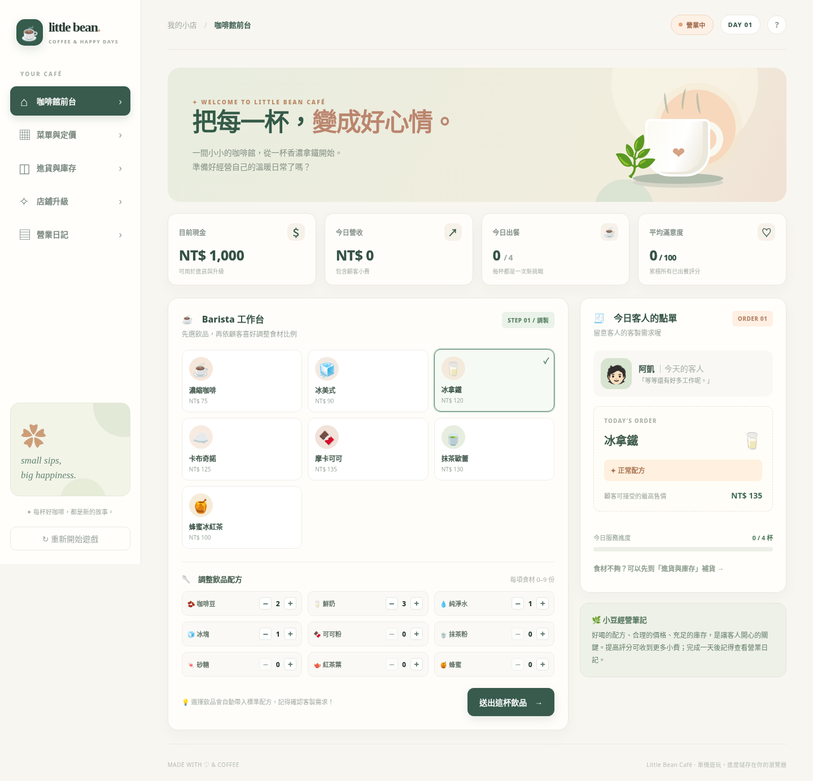

# ☕ Little Bean Café｜小豆咖啡館

一款療癒風格的 **咖啡廳經營模擬網站**。玩家從一家小小的咖啡館開始，按照顧客點單製作飲品、客製化配方、經營庫存與價格、投資升級，挑戰讓顧客滿意。

> 第九週 `AGENTS.md` 作業：示範如何以一份 AI 協作規範，讓後續修改者能維持同樣的架構、版型、命名和遊戲規則，快速新增飲品與玩法。

## 📷 網站預覽



手機版請參考 [`docs/mobile-preview.png`](docs/mobile-preview.png)。

## ⭐ 已實作功能

- **接單出餐**：每日隨機顧客，指定飲品與加／減食材需求。
- **互動配方工作台**：7 款飲品、9 種食材，按 `＋／－` 調整比例，系統依品項、配方、價格評分。
- **營運指標**：現金、每日營收、出餐數、平均滿意度、額外小費。
- **進貨庫存**：食材消耗、庫存不足阻止出餐、付費補貨。
- **菜單定價**：每款飲品可調整售價，價格高於顧客預算會降低評分。
- **四種店鋪升級**：節省咖啡豆、增加小費、增加每包補貨數、增加隔日起來客數。
- **每日結算與紀錄**：打烊、進入新一天，查看每日收入、支出、淨現金流與成就。
- **本機自動存檔**：使用瀏覽器 `localStorage`，重新整理後保留進度；可匯出紀錄 JSON。
- **響應式介面**：支援桌面與手機、按鈕鍵盤操作，沒有外部 API。

## 🎮 怎麼玩

1. 打開 `index.html`。
2. 在「咖啡館前台」按「開始第 1 天營業」。
3. 讀取右側訂單：飲品、客製需求、顧客最高可接受售價。
4. 在左側選飲品。系統先帶入標準配方，再用 `＋／－` 微調。
5. 按「送出這杯飲品」，查看滿意度及小費。
6. 需要食材就到「進貨與庫存」，想賺更多可到「菜單與定價」「店鋪升級」。
7. 完成所有訂單，按「打烊，完成今日結算」，再進入下一天。

**新手提示**：第 1 天第 1 位客人一定點「正常冰拿鐵」，直接選冰拿鐵即可得到標準配方。飲品需求如果顯示「多加一份鮮奶」，就在調配區把鮮奶數量加 1。

## 🧰 技術與啟動方式

- HTML5、CSS3、原生 JavaScript。
- 0 個第三方套件、0 個伺服器端功能。
- 直接雙擊 `index.html` 就可以玩；也可使用 VS Code Live Server。
- `node` 只用於執行開發測試，不是網站運作的必要條件。

執行自動測試（有安裝 Node.js 時）：

```bash
node --test tests/game.test.js
```

## 📁 檔案結構

```text
little-bean-cafe/
├── index.html                   # 網站入口、主框架、玩法說明
├── AGENTS.md                    # AI 持續開發規則（這次作業重點）
├── README.md                    # 專案說明、啟動與部署
├── .nojekyll                    # GitHub Pages 使用靜態檔案
├── assets/
│   ├── data.js                  # 7 款飲品、9 種食材、顧客、升級、成就
│   ├── engine.js                # 純函式遊戲邏輯與狀態運算
│   ├── app.js                   # 畫面、按鈕、localStorage
│   ├── style.css                # 視覺與 RWD
│   └── favicon.svg              # 網站圖示
├── tests/
│   └── game.test.js             # 自動測試
└── docs/
    ├── extension-example.md    # AI 如何依規則擴充的示範
    └── submission-template.md  # 老師繳交格式範本
```

## 🚀 部署到 GitHub Pages

1. 登入 [GitHub](https://github.com/new)，建立 **Public** repository，例如 `little-bean-cafe`。
2. 上傳本資料夾中的**所有內容**到儲存庫根目錄。請確保 `index.html`、`AGENTS.md` 都直接位於根目錄，而不是多包一層資料夾。
3. 到儲存庫 **Settings → Pages**。
4. 在 **Build and deployment → Source** 選 **Deploy from a branch**。
5. 在 Branch 選 **main**、資料夾選 **/(root)**，按 **Save**。
6. 部署完成後，網站通常會在 `https://<你的帳號>.github.io/little-bean-cafe/`。
7. 開啟網站、試玩第一天，確認遊戲正常再交作業。

**重要**：只有你本人在 GitHub 完成上傳／部署後，才會有真正的公開網址；本專案本身不宣稱已上線。

## 🔁 為什麼有 `AGENTS.md`？

一般 Vibe Coding 常著重「先做出一個網站」。本專案進一步將架構、設計風格、資料格式、遊戲公式、存檔相容性、測試和 GitHub Pages 限制寫成可重複使用的開發規範。之後只需請 AI「新增一款飲品」，就應沿用相同頁面與玩法，不必再從零解釋需求。

建議把 `AGENTS.md` 給 AI 看，並試試 `docs/extension-example.md` 的「蜂蜜拿鐵」擴充範例。任何擴充都必須先跑自動測試；新增資料欄位也必須注意既有存檔相容性。

## ⚠️ 已知限制

- 日誌、遊戲紀錄不傳送至伺服器；但**不同裝置／瀏覽器間不會自動同步**。
- 目前提供「匯出存檔」，沒有「匯入存檔」。勿將匯出備份誤認為雲端同步功能。
- 顧客及訂單由本機演算法產生；這是模擬遊戲，不使用 AI 模型或真人顧客資料。
- 「淨現金流」為每日營收加小費減去當天補貨／升級支出，並不等於真實企業的會計利潤。
- 瀏覽器清除本網站的網站資料會失去遊戲進度，請有需要時先匯出紀錄。

## 🏫 作業繳交

詳見 [`docs/submission-template.md`](docs/submission-template.md)，補入你的學校、學號、系級、姓名、GitHub 網址、公開網站網址即可。
